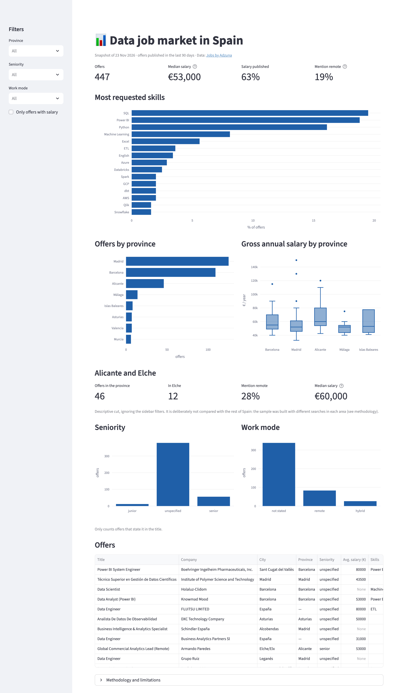
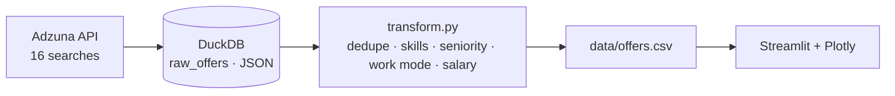

# 📊 Data Job Market in Spain

[](https://github.com/thiagoCardoso13/JobOffersPainel/actions/workflows/ci.yml)

[](https://spain-data-job-market.streamlit.app)

### 🔗 [Live demo → spain-data-job-market.streamlit.app](https://spain-data-job-market.streamlit.app)

**What do data job offers in Spain actually ask for, and what does that look like in Alicante/Elche?**

An end-to-end data project: job-offers API → DuckDB → cleaning and enrichment in Python → interactive dashboard.
It collects ~570 Spanish job postings, removes duplicate ads, extracts skills, seniority, work mode and salary,
and serves the result in a Streamlit dashboard.

It was built under a **free-tier quota of just 25 API calls**, so the sampling strategy and its biases are documented
openly (see [Design decisions and limitations](#design-decisions-and-limitations)).



## Key findings

Snapshot of 23 Nov 2026 · 447 data-role offers published in the last 90 days.

| Finding | Caveat |
|---|---|
| 🛠️ **SQL and Power BI** appear in ~19% of offers, **Python** in ~16% | Excel only in ~6%. The sample is biased towards the terms I searched (see limitations) |
| 👶 Only **12 of 447** offers (≈3%) call themselves *junior* in the title | versus 56 *senior*: the visible market leans towards experienced profiles |
| 💶 Median salary **€53,000** gross/year | only 63% of offers publish a salary, and those that do tend to pay more |
| 🏠 **19%** mention remote work | a lower bound: only the title and a 500-character snippet are read |
| 📍 **46** offers in the province of Alicante, **12** in Elche | descriptive cut, deliberately not compared with other areas |

## How it works



1. **Extraction** (`adzuna.py`, `snapshot.py`): 16 hand-picked searches (Spanish and English terms, all of Spain plus
   Alicante/Elche). A persistent call counter aborts before the free quota is spent.
2. **Storage** (`db.py`): raw JSON in DuckDB, idempotent (`INSERT OR REPLACE` per offer).
3. **Transformation** (`transform.py`): removal of repeated ads, detection of 25 skills (tools and language) with
   regular expressions, seniority (junior/senior), work mode (remote/hybrid), salary cleaning and a "data role" filter.
4. **Visualization** (`app.py`): filters by province, seniority and work mode; KPIs, skills, salaries, and a table with a
   link to every original offer.

## Run locally

```bash
python3 -m venv .venv && source .venv/bin/activate
pip install -r requirements-dev.txt

streamlit run app.py                      # the dashboard reads data/offers.csv, already included

# To regenerate the data you need keys from https://developer.adzuna.com:
cp .env.example .env                      # fill in ADZUNA_APP_ID and ADZUNA_APP_KEY
PYTHONPATH=src python -m painel.snapshot  # spends 16 calls of the quota
PYTHONPATH=src python -m painel.transform

PYTHONPATH=src pytest                     # tests
```

## Design decisions and limitations

- **25-call quota.** Adzuna's free plan gives 25 test calls in total, so this is a *snapshot*, not a daily pipeline.
  The call counter (`_spend_call`) aborts before the quota is exhausted.
- **A sample, not a census.** Searches were chosen by hand. Searching for "Power BI" or "Python SQL" inflates those
  tools compared with the real market.
- **Alicante vs. Spain comparison dropped.** The first version compared skills by area, but the searches for each
  area were not equivalent, so the result would have been an artifact. It was replaced with a descriptive cut.
- **Truncated descriptions.** The API returns only the first 500 characters, so detected skills and work mode are a
  lower bound.
- **Duplicate ads.** Employers repost the same ad across languages or cities. 76 were removed (same company plus the
  same description or title). Without this, one offer weighed several times in Alicante.
- **Heuristic "data role" filter.** Tuned after inspecting the data (for example, "Data Center Technician" no longer
  counts), but still a heuristic.
- **Seniority from the title only.** `junior` / `senior` are detected only when they appear in the title.

## Next steps

- [ ] Scheduled runs with GitHub Actions and incremental storage (needs an API plan with a larger quota).
- [ ] A **dbt** modelling layer (staging → marts) on top of DuckDB.
- [ ] More robust skill extraction (larger dictionary / NER) with full descriptions.
- [ ] A second data source to cross-check the sampling bias.

## Project structure

```
├── app.py                  # Streamlit dashboard
├── src/painel/             # adzuna.py · db.py · snapshot.py · transform.py
├── tests/                  # pytest: skills, seniority, work mode, role filter, idempotency
├── scripts/screenshots.py  # generates the docs/ screenshots with Playwright
├── data/offers.csv         # processed data (no description text)
└── .github/workflows/      # CI: tests on every push
```

## Data and attribution

Job data: **[Jobs by Adzuna](https://www.adzuna.es)**, obtained through their official API for personal/research use
under their [terms](https://developer.adzuna.com/docs/terms_of_service). This repository publishes only processed
metadata (title, company, location, salary) with a link to each original offer; it does not include description texts.

---
Built by **Thiago Bastos Cardoso** · Junior Data Analyst based in Elche, Spain · [GitHub](https://github.com/thiagoCardoso13)
